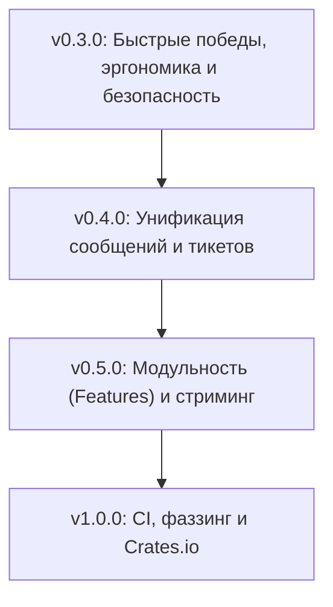

# Roadmap / План развития iroh-p2p-core

Стратегический план развития библиотеки `iroh-p2p-core` на основе анализа реальной кодовой базы ядра и зависимых проектов [Glyph](https://github.com/glyph-messenger/glyph) (децентрализованный мессенджер) и [Rune](https://github.com/glyph-messenger/rune) (mesh VPN).

---

## 1. Контекст и статус интеграции

Библиотека `iroh-p2p-core` служит общим криптографическим и транспортным фундаментом для P2P-нод на базе `iroh`.

### Текущий статус в проектах:
- **Rune**:
  - Использует: `EndpointId`, `Identity`, `WireSignature`, `PeerBook`, `ReplayFilter`, `framing`.
  - Дублирует:
    - Конверсии `ticket ↔ EndpointAddr` в `rune-net/src/addr.rs`.
    - Тройной бойлерплейт `sign_bytes/sign/verify` в `rune-protocol/src/messages.rs` (`JoinRequest`, `PeerAnnouncement`, `PeerLeave`).
    - Ручную генерацию nonce через зависимость `rand 0.8` в `rune-core/src/host.rs`.
- **Glyph**:
  - Использует: `EndpointId`, `ENDPOINT_ID_LEN`, `SIGNATURE_LEN`, `Identity`, `verify`, `ReplayFilter`, `PeerBook`.
  - Дублирует / обходит:
    - Собственный `SignedEnvelope` поверх **Cap'n Proto** (`glyph-protocol/src/codec.rs`).
    - Генерацию nonce через хак с `uuid::Uuid::new_v4()` (`glyph-protocol/src/ids.rs`).
    - Конверсии тикетов в `glyph-net/src/addr.rs`.

> [!IMPORTANT]
> **Различие сериализаторов:** Rune использует `bincode`, а Glyph — `capnp` (Cap'n Proto). Любые абстракции подписи и конвертов в ядре должны быть независимы от формата сериализации полезной нагрузки (работать со слайсами байт `&[u8]` или через generic writer).

---

## 2. Поэтапный план релизов (Milestones)



---

### Milestone 1: v0.3.0 — Быстрые победы, эргономика и безопасность

> **Цель:** закрыть базовые потребности зависимых проектов в мелких утилитах, устранить ненужные зависимости (`rand 0.8`), повысить безопасность памяти и производительность.

#### 1.1 Модуль `nonce`
- [ ] Добавить модуль `src/nonce.rs`:
  ```rust
  pub const NONCE_LEN: usize = 16;
  pub fn random_nonce() -> [u8; NONCE_LEN];
  ```
- [ ] Реализовать на базе прямого `getrandom` (без тяжелого `rand`).
- [ ] **Эффект:** Rune удаляет `rand 0.8` из `rune-core`, Glyph убирает хак с `uuid::new_v4()` в генерации nonce сообщений.

#### 1.2 Модуль `time`
- [ ] Добавить модуль `src/time.rs`:
  ```rust
  pub fn unix_now_ms() -> u64;
  ```
- [ ] **Эффект:** единый источник системного времени в миллисекундах для replay-фильтров и протокольных меток.

#### 1.3 Улучшение `EndpointId`
- [ ] **Serde-адаптер для форматов:**
  - В human-readable форматах (JSON, TOML, YAML) сериализовать как hex-строку (`"a1b2..."`).
  - В бинарных форматах (bincode, postcard) сохранять компактные 32 байта `[u8; 32]`.
- [ ] Трейты: `AsRef<[u8; 32]>`, `Borrow<[u8; 32]>`, `AsRef<[u8]>`.
- [ ] Оптимизация `to_hex()`: константный lookup-буфер вместо цикла с форматированием через `write!`.

#### 1.4 Безопасность и тестирование `Identity`
- [ ] **Zeroize при Drop:** очистка секретного ключа в памяти (`zeroize::ZeroizeOnDrop`).
- [ ] Метод `Identity::from_seed([u8; 32])` для воспроизводимых тестов в обоих проектах.
- [ ] Добавить версию/magic в формат файла сохранения ключа (с обратной совместимостью по размеру 32 байта для legacy-файлов).

#### 1.5 Оптимизация `PeerBook`
- [ ] Устранить O(N²) клонирований в `PeerBook::update()` при добавлении списка IP и relay.
- [ ] Добавить методы `snapshot() -> HashMap<EndpointId, EndpointAddr>` и `len()`, `is_empty()`.

#### 1.6 Статус `ticket`
- [x] Распространение ошибок сериализации в `sign_bytes() -> Result<Vec<u8>>` *(выполнено в dcd379d)*.
- [ ] Реализация `Display` и `FromStr` для `SignedTicket<T>`.

---

### Milestone 2: v0.4.0 — Унификация подписанных сообщений и тикетов

> **Цель:** радикально сократить дублирование протокольного кода в Rune (`messages.rs`) и Glyph (`addr.rs`, `identity.rs`).

#### 2.1 Паттерн «Подписанные структуры» (`Signable` / `Signed<T>`)
- [ ] **Архитектурное решение:** поддержка как bincode (Rune), так и Cap'n Proto (Glyph).
  
  **Подход: Обобщенный трейт + обертка `Signed<T>`:**
  ```rust
  /// Трейт канонической сериализации для подписи
  pub trait Signable {
      fn write_canonical_payload<W: std::io::Write>(&self, writer: &mut W) -> std::io::Result<()>;
  }

  /// Обертка полезной нагрузки с сигнатурой
  #[derive(Clone, Debug, Serialize, Deserialize)]
  pub struct Signed<T> {
      pub payload: T,
      pub signature: WireSignature,
  }

  impl<T: Signable> Signed<T> {
      pub fn sign(payload: T, identity: &Identity, domain: &'static [u8]) -> Result<Self>;
      pub fn verify(&self, signer: &EndpointId, domain: &'static [u8]) -> Result<()>;
  }
  ```
- [ ] Набор тестов на защиту от подделки (tampering) и разделение доменов (domain separation).
- [ ] Миграция `rune-protocol/src/messages.rs` (удаление ~200 строк бойлерплейта).

#### 2.2 `TicketAddrInfo`
- [ ] Выделить сетевую часть тикета в отдельный тип:
  ```rust
  #[derive(Clone, Debug, PartialEq, Eq, Serialize, Deserialize)]
  pub struct TicketAddrInfo {
      pub relay_url: Option<String>,
      pub direct_addrs: Vec<SocketAddr>,
  }

  impl TicketAddrInfo {
      pub fn from_endpoint_addr(addr: &EndpointAddr) -> Self;
      pub fn to_endpoint_addr(&self, id: EndpointId) -> Result<EndpointAddr>;
  }
  ```
- [ ] Интегрировать `TicketAddrInfo` в `SignedTicket<T>`.
- [ ] Мигрировать `rune-net/src/addr.rs` и `glyph-net/src/addr.rs` на общий конвертер.

#### 2.3 `ReplayFilter` v2 (Multi-Peer / Multi-User)
- [ ] **`SenderReplayFilter` / `PeerReplayFilter`:**
  - Шардирование фильтров по `EndpointId` (защита от того, чтобы один шумный пир вытеснял nonce других пиров из общего буфера).
- [ ] **Двухфазная валидация:** раздельные методы `check(ts, nonce)` и `record(ts, nonce)` для атомарных проверок перед применением состояния.
- [ ] Возможность внедрения функции времени (`now_fn: fn() -> u64`) для детерминированных тестов.
- [ ] Метод явной очистки устаревших записей `prune()`.

---

### Milestone 3: v0.5.0 — Модульность (Feature Flags) и I/O

> **Цель:** облегчить зависимости ядра, добавить потоковый фрейминг и управление жизненным циклом пиров.

#### 3.1 Расщепление на Feature Flags
Сейчас `iroh-p2p-core` тащит тяжелый крейт `iroh` (с QUIC-стеком, rustls и tokio) даже для чисто криптографических модулей.
- [ ] Выделить фичи в `Cargo.toml`:
  - `default = ["iroh"]`
  - `core` (минимальный): `endpoint_id`, `identity`, `signature`, `replay`, `time`, `nonce` — только `iroh-base` (быстрая сборка, нет сетевого стека).
  - `framing`: модуль `framing` (зависит от `tokio/io-util`).
  - `iroh`: модули `peerbook` и интеграция `EndpointAddr` в `ticket` (зависит от полного `iroh`).

#### 3.2 `FramedStream<T>` и конфигурация фрейминга
- [ ] Структура конфигурации `FramingConfig`:
  ```rust
  pub struct FramingConfig {
      pub max_frame_size: usize,
      pub flush_immediately: bool,
  }
  ```
- [ ] Асинхронный кодек-обертка `FramedStream<S, T>` над `AsyncRead + AsyncWrite`.
- [ ] Опциональная поддержка varint-длин для экономии байт на частых мелких управляющих сообщениях (Ping/Pong в Rune).

#### 3.3 PeerBook TTL & Eviction
- [ ] Хранение времени последнего обновления записи пира (`last_seen`).
- [ ] Метод выселения устаревших пиров `evict_older_than(Duration)`.
- [ ] Serde-сериализация каталога (`save(&Path)` / `load(&Path)`) для сохранения состояния при перезапуске демонов.

#### 3.4 Вспомогательные сетевые примитивы
- [ ] **Rate Limiting (`rate`)**: потокобезопасный Token Bucket с привязкой к `EndpointId` (защита от спама запросов присоединения).
- [ ] **Backoff (`backoff`)**: экспоненциальный backoff с джиттером для P2P-переподключений.

---

### Milestone 4: v1.0.0 — Инфраструктура качества и Crates.io

> **Цель:** стабилизация API, публикация на crates.io, исключение git-зависимостей в экосистеме.

- [ ] **CI (GitHub Actions):**
  - Матрица тестов Linux / macOS / Windows.
  - Проверка всех комбинаций feature-флагов (`--no-default-features`, `--all-features`).
  - `cargo fmt --check`, `cargo clippy -- -D warnings`.
- [ ] **Фаззинг и Proptest:**
  - Proptest для тикетов (roundtrip `SignedTicket ↔ Base32`).
  - Фаззинг парсера Base32 и фрейминга на поврежденных и злонамеренных входных данных.
- [ ] **Бенчмарки:**
  - Измерение пропускной способности `framing` и задержки `ReplayFilter::check_and_record` под многопоточной нагрузкой.
- [ ] **Документация и релиз:**
  - Включение `#![warn(missing_docs)]` на всех публичных API.
  - Описание архитектуры в `README.md` с примерами интеграции.
  - Публикация первой стабильной версии на [crates.io](https://crates.io).

---

## 3. Рекомендуемый порядок выполнения ближайших задач

1. **`src/nonce.rs` + `src/time.rs`** — изолированные функции с мгновенной пользой для обоих проектов.
2. **`EndpointId` serde & ergonomics** — hex в JSON, поддержка AsRef/Borrow, оптимизация `to_hex`.
3. **`Identity::from_seed` и `zeroize`** — безопасность и удобство тестов.
4. **`Signable` / `Signed<T>`** — решение проблемы дублирования в `rune-protocol` и `glyph-protocol`.
5. **`TicketAddrInfo`** — унификация конверсий адресов тикетов.
6. **Feature flags в `Cargo.toml`** — разделение `core` и полного `iroh`.
